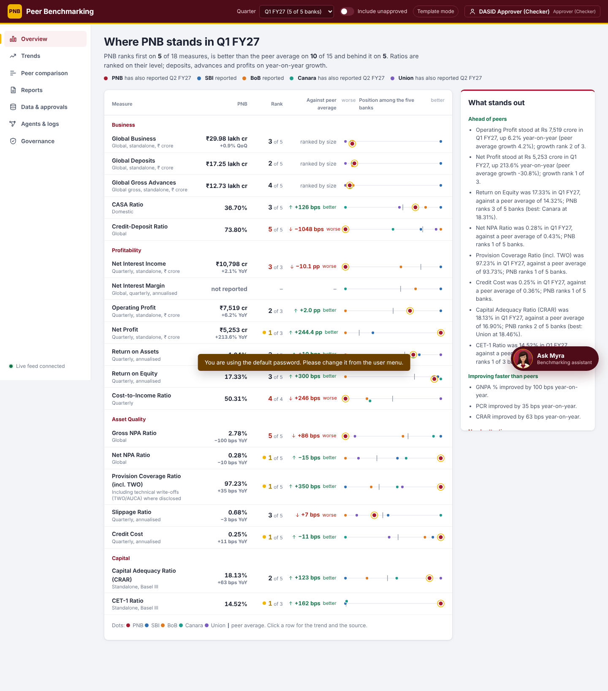

# PNB Peer Benchmarking

Benchmarks Punjab National Bank against State Bank of India, Bank of Baroda, Canara Bank and Union Bank of India
on 19 KPIs, quarter by quarter for up to five years. Agents collect each bank's published analyst and investor
presentations, read the KPIs, cross-check them and stage them; a human approver accepts them; management then
sees rankings, trends, reports and a chat assistant (Myra) built only on approved figures. Every number links back
to the bank's document and page, and every action is recorded in a tamper-evident audit trail.

The application is one Python web server with a built-in web interface. It runs on Linux (the GB10) or Windows,
needs no internet beyond the five bank websites, and uses a local language model when one is available.
No data leaves the server.



## Documentation

| Read this | If you want to |
| --- | --- |
| [docs/INSTALL-LINUX.md](docs/INSTALL-LINUX.md) | install and run it on Ubuntu / the GB10, keep it running, update it |
| [docs/INSTALL-WINDOWS.md](docs/INSTALL-WINDOWS.md) | install and run it on a Windows PC or Windows Server |
| [docs/INTEGRATION.md](docs/INTEGRATION.md) | open it from a tab of the Top Management Dashboard (link, one-click sign-in, or embedded) |
| [docs/ARCHITECTURE.md](docs/ARCHITECTURE.md) | understand the design: layers, agents, extraction, maker-checker, Myra, security |

## Quick start

**Linux (Ubuntu, GB10)** - in a terminal inside this folder:
```bash
./setup.sh      # once: libraries, settings file, optional AI model, self-test
./run.sh        # every time: starts the app and prints the address to open
```

**Windows** - in this folder, double-click **setup.bat** once, then **run.bat** every time.

Then open the printed address (default port **8077**) and sign in.

## Users and roles

| User ID | Role | Can do |
| --- | --- | --- |
| `analyst` | Analyst (maker) | run data collection, upload PDFs, generate reports, view, chat |
| `approver` | Approver (checker) | approve / reject / correct values, approve reports, view, chat |
| `gm` | Top Management (viewer) | view approved data, chat |
| `admin` | Administrator | everything, plus the user list |

The starter password for all four is set by `DEFAULT_PASSWORD` in `.env` (default `Pnb@12345`). Change every
password after the first sign-in (top-right menu, Change password). Nobody can approve values or reports they
produced themselves (four-eyes rule).

## Everyday commands

Run these inside the folder with the private Python environment active
(Linux: `source .venv/bin/activate`; Windows: `.venv\Scripts\activate`).

| Command | What it does |
| --- | --- |
| `python -m app.cli selftest` | checks extraction accuracy and the whole pipeline in a temporary folder |
| `python -m app.cli discover` | lists the PDF links the Source Scout can see on each bank site |
| `python -m app.cli collect` | runs data collection from the terminal (`--offline` = inbox only, `--no-llm` = rules only) |
| `python -m app.cli add-user <id> viewer --name "Full Name"` | adds a user (roles: admin, maker, checker, viewer) |
| `python -m app.cli reset-password <id>` | resets a password and unlocks the account |
| `python -m app.cli link <viewer-id> --tab trends` | prints a one-time sign-in link (tests the dashboard hand-off) |
| `python -m app.cli verify-audit` | checks the audit hash chain |
| `python -m app.cli netcheck` | explains why libraries cannot be downloaded (proxy, mirror) |

## What is where

| Path | Contents |
| --- | --- |
| `app/` | the Python application (API, agents, extraction, benchmarking, chatbot, security) |
| `static/` | the web interface (plain JavaScript and CSS, no internet needed) |
| `config/sources.yaml` | which bank pages are read and which links are accepted |
| `app/catalog.py` | the KPI dictionary: definitions, each bank's wording, plausible ranges |
| `.env` | this installation's settings and secrets (created by setup, never committed) |
| `data/` | database, downloaded PDFs, inbox, generated reports, logs (created at run time, never committed) |
| `tests/fixtures/` | text and PDFs used only by the self-test |
| `deploy/` | example service file to keep the app running on Linux |

## Requirements

- Python 3.10 or newer (3.12 recommended)
- About 1 GB of disk for libraries and five years of PDFs
- Optional: [Ollama](https://ollama.com) with `qwen2.5:14b` and `nomic-embed-text` for AI wording and semantic search.
  Without it the app runs in template mode; extraction, approval, benchmarking and reports work the same.
