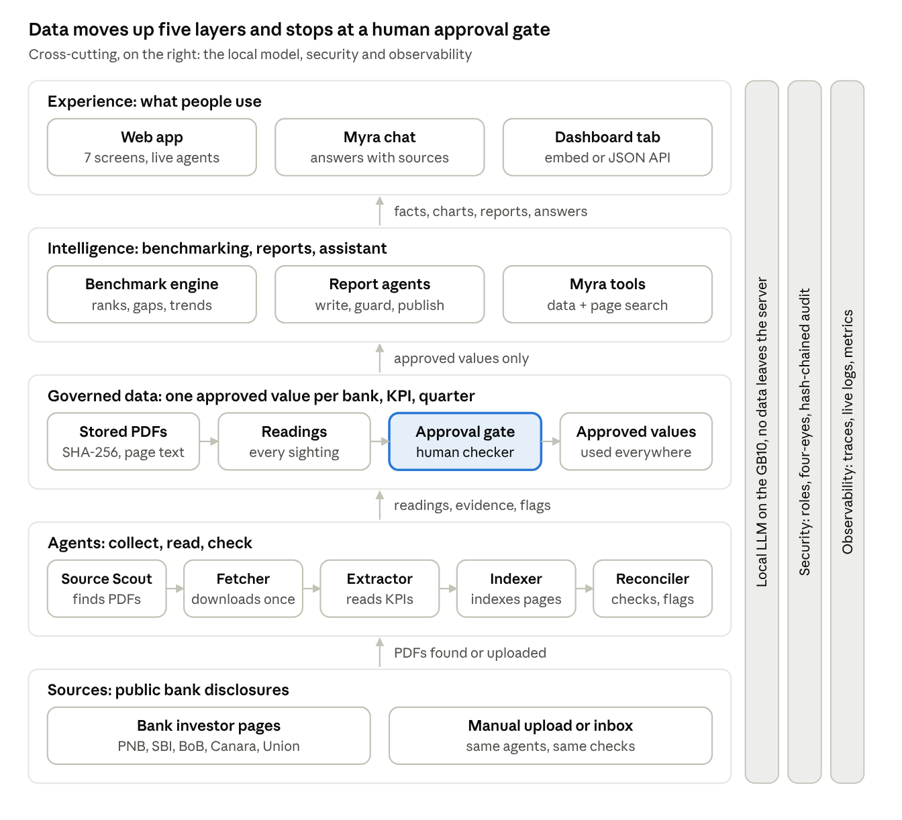
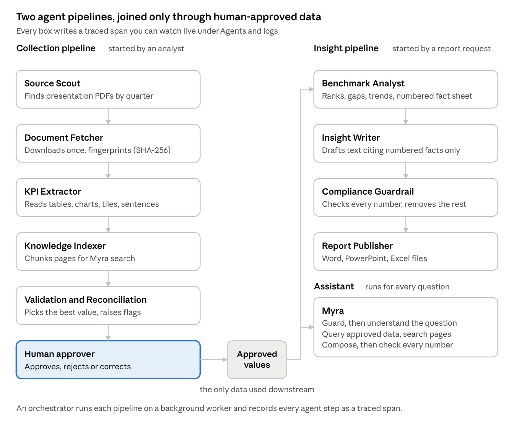

# Architecture and design

High-level and low-level design of PNB Peer Benchmarking: what each layer and agent does, how a figure travels from a bank's website to the dashboard, and the controls around it. Installation is covered in [INSTALL-LINUX.md](INSTALL-LINUX.md) and [INSTALL-WINDOWS.md](INSTALL-WINDOWS.md); dashboard integration in [INTEGRATION.md](INTEGRATION.md).

## Purpose and requirement coverage

The application benchmarks PNB against SBI, Bank of Baroda, Canara Bank and Union Bank of India on 19 KPIs, for up to 20 quarters, using figures read automatically from each bank's published analyst and investor presentations. It runs as a standalone web application on the GB10 and is built to become the Peer Benchmarking tab of the Top Management Dashboard.

The design rests on three rules: every number comes from a bank's own public document, no number reaches management until a human approver accepts it, and every number can be traced to its document, page and approver.

| RFP requirement | How the application meets it | Where to see it |
| --- | --- | --- |
| Peer benchmarking engine: automated dashboards comparing the bank against peers using internal and external data | Agents collect presentations from the five banks' investor pages, extract KPIs, reconcile them and rank PNB against peers and the peer average | Overview, Trends, Peer comparison |
| Quarter-wise trend analysis for up to 5 years | 20-quarter window (Q3 FY22 to Q2 FY27); history is also read from the comparison columns and charts inside newer decks | Trends (2, 3, 5 years) |
| Point-in-time analysis till the last reporting quarter | Quarter selector; defaults to the latest quarter in which all five banks have reported, and shows which banks are awaited | Overview header, quarter selector |
| Data from analyst and investor presentations | Source registry of the five investor-relations pages; manual upload and inbox folder as fallback | Data & approvals, Sources |
| Automated text and visual content: tables, benchmarking reports, quarterly briefs, speeches, executive summaries, presentations, actionable insights | Five report types generated from a numbered fact sheet: Word, native-chart PowerPoint and Excel | Reports |
| Data privacy | Local language model only; outbound calls to non-local model endpoints are refused; personal-data redaction | Governance, Controls |
| Audit trails | Hash-chained audit log of every sign-in, approval, override, report and export, with one-click verification | Governance, Audit trail |
| Regulatory compliance | Maker-checker with four-eyes rule, role-based access, lineage to source page, provisional data never shown to management | Data & approvals, lineage drawer |
| Responsible AI governance | Model and prompt registers, grounding check on every AI sentence, AI-disclosure on reports, template fallback | Governance, Reports |
| Observability (your requirement) | Every agent step traced, logs streamed live, metrics and Prometheus endpoint | Agents & logs |

The note in the RFP excerpt that reads "Information only for Q1 and Q2, decision may be taken in…" is cut off in the screenshot. It has been treated as non-blocking; confirm its meaning with the RFP owner.

## High-level design

The system is five layers in one process, and data only moves upward after a human has approved it.

Read it bottom to top. Public disclosures feed a team of collection agents; their readings land in a governed store where an approver turns staged values into approved ones; only approved values feed the benchmark engine, the report agents and Myra; people see the results in the web app, in chat, or inside the Top Management Dashboard. The local language model, the security controls and observability serve every layer rather than sitting in one of them.

## Technology stack

Everything is open source, runs in one Python process on the GB10, and needs no internet beyond the five bank websites. The web interface loads no external scripts or fonts, so it works on the bank's closed network.

| Layer | Technology | Why this choice |
| --- | --- | --- |
| Web server and API | Python 3.10+, FastAPI, Uvicorn | One process serves the REST API, the live event stream and the web pages; automatic OpenAPI documentation at /docs for the dashboard team |
| Database | SQLite in WAL mode via SQLAlchemy 2 | Zero administration for a single server; the same code runs on PostgreSQL by changing DB\_URL |
| Web collection | httpx (polite client: robots.txt, pause between requests, retries), BeautifulSoup, optional Playwright headless Chromium | Static pages need only HTTP; the headless browser is used only if a site hides links behind JavaScript |
| PDF reading | pdfplumber (text layer, parallel worker processes) | Exact text and numbers as printed; image-only pages are detected and flagged |
| KPI extraction | In-house rule engine (tables, charts, key-value tiles, sentences) with a synonym dictionary | Deterministic, explainable and fast; checked at 90 of 91 correct on five real decks |
| Language model | Ollama with qwen2.5:14b (or any OpenAI-compatible local server such as vLLM); nomic-embed-text for embeddings | Runs on the GB10, no data egress; used only where rules cannot do the job |
| Search for Myra | BM25 keyword index plus optional embeddings, fused with Reciprocal Rank Fusion | Finds management commentary even when wording differs |
| Reports | python-docx, python-pptx (native, editable charts), openpyxl, matplotlib | Board-ready Word, PowerPoint and Excel in PNB maroon and gold |
| Web interface | Plain JavaScript modules, hand-drawn SVG charts, CSS | No CDN, no build step, works offline; embeddable with ?embed=1 |
| Security | PBKDF2 password hashing, HMAC-signed sessions, role checks on every endpoint, strict Content-Security-Policy | Standard, auditable controls with no external identity dependency |
| Observability | Python logging to database and rotating JSON file, Server-Sent Events, Prometheus text endpoint | Live view in the app plus hooks for the bank's monitoring tools |

## The agents and how they hand off

Nine agents in two pipelines plus the assistant, each with one job, one set of tools and a written contract of what it reads and produces. The collection pipeline ends at a human; the insight pipeline and Myra start from what that human approved.

Agents pass work through the database, not through each other's memory: the Scout registers documents, the Fetcher marks them downloaded, the Extractor writes candidates, the Reconciler writes staged values. That makes every hand-off inspectable and lets a failed run be re-run from where it stopped.

| Agent | Reads | Produces | Uses the language model? |
| --- | --- | --- | --- |
| Source Scout | config/sources.yaml, the five investor pages, the inbox folder | Document records with bank and quarter | No |
| Document Fetcher | Discovered documents | Stored, fingerprinted PDFs | No |
| KPI Extractor | PDF pages | Candidates with page and evidence; page text | Only as fallback for a missing KPI |
| Knowledge Indexer | Page text | Search chunks, optional embeddings | Embeddings only |
| Validation & Reconciliation | Candidates, previous values | Staged values, flags, findings, derived KPIs | No |
| Benchmark Analyst | Approved values | Scorecard and numbered fact sheet | No |
| Insight Writer | Fact sheet, report specification | Draft narrative | Yes, or template |
| Compliance Guardrail | Draft, fact sheet | Checked text, grounding score | No |
| Report Publisher | Checked text, scorecard, trends | Word, PowerPoint, Excel files; report record | No |
| Myra | Question, approved values, search chunks | Answer, chart, sources | Optional, for wording and intent |

The orchestrator allows one collection run at a time (a second request is refused with a clear message) and up to three report or chat runs alongside it.

## From a bank website to a number on the dashboard

A single figure, PNB's Gross NPA of 2.55% for Q2 FY27, travels through nine steps. Each step is a recorded span you can show live under Agents & logs.

1. **An analyst starts a run.** On Data & approvals they pick the banks, the history (5 years) and the source (websites or inbox). The orchestrator creates a run ID and starts the collection pipeline on a background worker.
2. **Source Scout reads the investor page.** It fetches https://pnb.bank.in/financials-current.html after checking robots.txt, walks every link, and keeps PDFs whose text, title or table row says "analyst presentation" while dropping transcripts, Hindi versions, audio and press invitations (rules in config/sources.yaml). The period parser turns labels such as "Sept'26", "Q2FY27" or "30.09.2026" into the quarter Q2 FY27. Links outside the 20-quarter window are ignored.
3. **Document Fetcher downloads once.** It checks the file really is a PDF, computes its SHA-256 fingerprint and stores it as data/raw/PNB/Q2FY27\_\<hash>.pdf. A file already held with the same fingerprint is not downloaded again.
4. **KPI Extractor reads every page.** pdfplumber extracts the text layer in parallel processes. The rule engine finds "Gross NPA %" in a chart on page 4 (nine quarters of history, Sept'24 to Sept'26) and in a table on page 11. Each sighting becomes a candidate with its value, method, confidence, page and the exact text it came from.
5. **Knowledge Indexer** splits pages into overlapping chunks so Myra can later quote management commentary; embeddings are added when the local model is available.
6. **Validation & Reconciliation decides.** Candidates for the same bank, KPI and quarter are clustered; the cluster with the most independent support wins. Here two readings agree at 2.55%. The agent also runs the checks: plausible range, NNPA below GNPA, quarter-on-quarter jumps, quarterly versus annualised basis, and banks still awaited. The value is staged with any flags.
7. **A human approver checks it.** On Review & approve they see the value, the readings, the flags and the source page text with the number highlighted. They approve, reject with a reason, or correct with a reason. The analyst who ran the pipeline cannot approve it.
8. **The benchmark engine uses only approved values.** It ranks the five banks (lower is better for GNPA), computes the peer average without PNB, the gap in basis points and the year-on-year movement.
9. **Everything downstream reads the same approved figure.** The Overview, Trends, Peer comparison, generated reports and Myra all show 2.55%, and each links back through the lineage drawer to page 4 of the stored PDF and to the approver's audit entry.

If a website cannot be reached from the bank network, the same PDF can be uploaded on screen or dropped in data/inbox/PNB/. From step 3 onwards the journey is identical.

## Low-level design: KPI extraction and terminology mapping

Extraction is rule-based first and AI second: four deterministic readers cover tables, charts, tiles and sentences, and the local model is called only for a KPI the rules could not find. On the text of five real decks the readers pick the correct value for 90 of 91 headline KPIs; the one miss (Bank of Baroda CET-1, drawn as a stacked chart with a reversed legend) is reported as missing so the approver can enter it.

| Reader | What it handles | Base confidence |
| --- | --- | --- |
| Table | Header rows of periods (Sept'25, June'26, Sept'26), growth columns between them, Quarterly/Cumulative pairs, two-line headers, serial-number columns | 0.92 |
| Sentence | Press-release prose such as "GNPA ratio improved to 1.47%", including "respectively" lists | 0.80 |
| Chart labels | Data labels printed above a period axis; several series matched to the titles in order; axis ticks removed; "lakh crore" scaled to crore | 0.75 |
| Key-value tile | Dashboard tiles such as "NIM 2.86%" | 0.72 |
| Local LLM fallback | A visible KPI still missing for the document's own quarter | 0.60 |

Safeguards inside the readers:

- **Guidance pages** ("FY27 guidance", targets) are read right-aligned so the actual column is used; such readings are cut to 65% confidence and flagged.
- **Future-quarter guard**: a value for a quarter after the document's own quarter is a projection and is dropped.
- **Consolidated and subsidiary pages** are skipped; the benchmark is on standalone figures.
- **LLM readings** must quote the value verbatim from the page and fall inside the KPI's plausible range; they carry the flag "Read by LLM", which keeps them out of bulk approval.
- **Image-only pages** (no text layer) are counted per document and shown as a warning so the approver knows to check them.

### Same KPI, different words

Each KPI has a reviewed dictionary entry: the phrases banks use (most specific first), phrases that must never match, a plausible range and a direction. A label is matched only if an accepted phrase is present and no excluded phrase is near it.

| KPI | Wording accepted across the five banks | Wording rejected |
| --- | --- | --- |
| Net NPA ratio | Net NPA %, NNPA ratio, Net NPA (%), NNPA | amounts, domestic, movement of NPA |
| Gross NPA ratio | Gross NPA %, GNPA ratio, GNPA (%), Gross NPA | amounts, additions, sector-wise rows |
| Provision coverage | PCR (incl. TWO), PCR %- (Incl. TWO), Provision coverage ratio including write-offs | excluding TWO, NCLT, w/o |
| CASA ratio | Domestic CASA share %, CASA ratio, CASA (Domestic CASA to domestic deposits) | CASA growth, CASA deposits amount |
| Slippage ratio | Slippage ratio, Gross slippage ratio, Delinquency ratio | slippage amount, fresh slippages in crore |
| Capital adequacy | CRAR, Capital adequacy ratio, Total (Tier I+II) % | consolidated, board-approved minimum |
| Cost-to-income | Cost to income ratio, Cost-income ratio, C/I ratio | staff cost, other cost |
| Net profit | Net profit, Profit after tax, PAT | consolidated, growth %, exceptional |

When a bank does not publish a KPI directly, it is derived and flagged "Derived": Global business = deposits + advances; CASA ratio = CASA deposits ÷ domestic deposits × 100; CD ratio = advances ÷ deposits × 100. The full dictionary, including excluded wording and ranges, is visible in the app under Governance, KPI dictionary.

## Low-level design: reconciliation, validation and maker-checker

One quarter's value is usually seen several times: in its own deck and in the history columns of the next four decks. The Validation & Reconciliation agent turns those sightings into one staged value and a list of reasons to look twice.

**Choosing the value.** Readings within tolerance (0.012 percentage points for ratios, 0.3% for amounts) are grouped. Each group scores the best confidence per document, plus 0.15 when the reading comes from the quarter's own deck, plus a bonus when different readers agree. The highest-scoring group wins; the others are kept as alternatives the approver can see.

**Re-runs never silently change approved data.** If a re-run reads the same approved number, it stays approved. If it reads a different number, the value goes back to the review queue flagged "Changed after approval". A manual correction is never overwritten.

| Flag | Raised when | Blocks bulk approval |
| --- | --- | --- |
| Sources disagree | Two readings differ beyond tolerance | Yes |
| Basis mismatch | One reading is about four times another (quarterly versus annualised) | Yes |
| Low confidence | Winning confidence below 70% | Yes |
| Unusual jump | Quarter-on-quarter move beyond the KPI's threshold (GNPA 25%, net profit 50%, PCR 10%) | Yes |
| Inconsistent | Net NPA not below gross NPA, CET-1 above CRAR, business not equal to deposits plus advances | Yes |
| Out of range | Outside the KPI's plausible range | Yes |
| Read by LLM | Value came from the model fallback | Yes |
| Changed after approval | A re-run disagrees with an approved value | Yes |
| Single source, Derived, Basis note, Manual override | Information for the approver | No |

The agent also writes findings that are not tied to one value: a bank whose latest quarter is still awaited, a KPI not found in a deck, image-only pages and failed downloads.

**Maker-checker.**

- Analysts (makers) run collection, upload PDFs and generate reports. Approvers (checkers) decide on values and sign off reports. Management (viewers) see approved data only.
- "Approve all clean values" accepts only values with no blocking flag and at least 70% confidence. Everything else needs an individual decision.
- A user cannot approve values from a run they started, or a report they generated (four-eyes rule).
- Rejecting needs a reason. Correcting needs a value inside the plausible range and a reason citing the source; the old value is kept as an alternative.
- Makers and checkers can switch on "Include unapproved" to preview staged data. Such views and reports are marked provisional, and a provisional report cannot be approved for circulation.
- Every decision is written to the hash-chained audit trail with user, time, old and new value.

## Benchmarking logic

Ratios are ranked on their level and amounts on year-on-year growth, because ranking deposits or profit by size would always put SBI first and say nothing about performance.

| Element | Rule |
| --- | --- |
| Default quarter | The latest quarter in which all five banks have reported; otherwise the latest with at least three. Banks still awaited are named on screen. |
| Rank for ratios | By value in the KPI's direction: higher is better for NIM, RoA, RoE, CASA, PCR, CRAR, CET-1; lower is better for GNPA, NNPA, cost-to-income, slippage, credit cost |
| Rank for amounts | By year-on-year growth; if year-ago figures are not yet collected, by size and labelled "ranked by size" |
| Peer average | Simple mean of SBI, Bank of Baroda, Canara Bank and Union Bank; PNB is excluded. In trend lines it is drawn only when at least three of the four peers reported, so it does not jump because the set of banks changed. |
| Gap | Ratios: PNB minus peer average, in basis points. Amounts: PNB growth minus peer growth, in percentage points. Marked better or worse using the KPI's direction. |
| Trend change | Ratios: change in basis points from the first to the last quarter shown. Amounts: annualised growth (CAGR) over the period. |
| Strength | PNB ranks first, or is better than the peer average by a material margin (at least 10 bps or 5% of the peer average for ratios; 1.5 pp for growth) |
| Concern | PNB ranks last, or is worse than the peer average by the same margin |
| Momentum | PNB improved year-on-year by more than the peers' average improvement |

The engine also produces a numbered fact sheet (F1, F2 …), one plain sentence per position, movement and best-in-class fact. Reports and Myra may use only these facts, which is what makes the generated text checkable.

## How Myra, the chatbot, works

Myra never answers from the model's memory. Numbers come from database queries over approved values, commentary comes from the indexed pages of the stored PDFs, and the model, when connected, only rewords what those tools returned; if its wording contains a number the tools did not supply, the wording is discarded.

Each question runs as a traced pipeline of six steps, visible as a "chat" run under Agents & logs:

1. **Guard.** Personal data (PAN, Aadhaar, phone, e-mail, account numbers) is redacted. Instruction-override attempts such as "ignore previous instructions" are refused politely, without calling the model.
2. **Understand.** Rules detect the intent (lookup, compare, trend, summary, definition, source, why, greeting, help) and the entities: KPI by any of its synonyms ("bad loans" means GNPA), bank by any alias ("BoB", "Baroda"), quarter ("Q2 FY27", "Sept 2026") and horizon ("last 8 quarters", "5 years"). When the model is available it can confirm the intent.
3. **Tools.** The intent selects a tool that reads approved data: lookup returns values with rank and peer average; compare ranks all banks and adds a bar chart; trend returns the series and a line chart; summary uses the fact sheet's strengths and concerns; definition reads the KPI dictionary; source returns the full lineage of one number.
4. **Retrieve.** For "why" questions and summaries, a hybrid search runs over page chunks: BM25 keyword ranking plus embedding similarity, merged with Reciprocal Rank Fusion and filtered by bank and quarter. This is how Myra quotes management commentary, with page numbers.
5. **Compose.** Without a model, a template writes the answer from the tool output. With a model, qwen2.5:14b receives only the tool output and the snippets, with instructions to copy numbers exactly, cite snippets and treat snippet text as untrusted.
6. **Check.** Every number in the model's answer must match a number supplied by the tools or the snippets (within rounding). If one does not, the model's text is rejected and the template answer is shown instead; the rejected text is kept in the trace.

Each reply shows how it was produced (intent, template or model, time taken), carries source chips that open the page text, and is stored with its intent, sources and latency for audit. Typical response time is under 50 ms in template mode; with the model it depends on GPU load (expect seconds, not minutes).

## Report generation and the grounding guardrail

Reports are written by four agents in sequence, and the third one exists to stop the second from inventing anything: every number in the text must exist in the fact sheet, or the sentence is removed.

| Report | Content | Files |
| --- | --- | --- |
| Executive summary | One page: where PNB leads, lags and what to watch | Word, PowerPoint |
| Quarterly performance brief | Business, profitability, asset quality and capital in turn | Word, Excel |
| Talking points / speech | Opening, what went well, what must improve, close; numbers phrased for speaking | Word |
| Actionable insights | Strengths, concerns and a suggested focus per concern | Word |
| Board pack | Scorecard tables, native trend and ranking charts, insights, method slide, data workbook with lineage | Word, PowerPoint, Excel |

1. **Benchmark Analyst** computes the scorecard for the chosen quarter and the numbered fact sheet.
2. **Insight Writer** drafts the narrative. With the model, the system prompt allows only fact-sheet content and requires a citation \[F#] after each claim. Without the model, a fixed template builds the same structure from the facts.
3. **Compliance Guardrail** extracts every number from the draft and matches it against the fact sheet (quarter labels, years and small counts are ignored). Unsupported sentences are removed; if that removes too much, the whole draft is replaced by the template. It also strips investment-advice phrasing and redacts personal data. The result is a grounding score, for example "24 of 24 numbers found (100%)".
4. **Report Publisher** builds the files in PNB maroon and gold: A4 Word with an AI-disclosure line, scorecard and charts and a landscape source appendix; PowerPoint with editable native charts; Excel with scorecard, trends, data and lineage.

The saved report records whether a model or the template wrote it, the model name, the prompt version (a hash of the prompt text), the grounding score and what the guardrail removed. It starts as a draft; another approver must approve it before circulation.

## Security, privacy, audit and responsible AI

The platform handles only public bank disclosures, yet it is built to the controls an internal banking system needs: nothing leaves the server, every action is attributable, and the record of actions cannot be edited without detection.

| Area | Control as implemented |
| --- | --- |
| Data residency | The model runs on the GB10. The LLM client refuses any non-local endpoint unless an administrator sets ALLOW\_REMOTE\_LLM, which is off by default. |
| Collection ethics | Only the five configured public investor-relations pages are read; robots.txt is obeyed; 1.5 s pause between requests; identifies itself as PNB research; TLS verification on. |
| Access control | Four roles (Administrator, Analyst, Approver, Management viewer) checked on every API call; the screen hides what a role cannot do, but the server is the enforcer. |
| Authentication | PBKDF2-SHA256 with 240,000 iterations; password policy (8+ characters, mixed case, digit, symbol); lock for 15 minutes after 5 failures; HMAC-signed session tokens with expiry; HttpOnly, SameSite=Strict cookie. |
| Segregation of duties | Four-eyes on values and on reports; provisional data never reaches management views or approvable reports. |
| Audit trail | Every sign-in, failed sign-in, run, approval, rejection, correction, report, download and export is appended with actor, time, details and, for sign-ins and approvals, the IP address. Each entry stores the SHA-256 of the previous entry, so any edit or deletion breaks the chain; Governance has a one-click verify. |
| Lineage | Each value keeps its document fingerprint, page, method, confidence, evidence text, alternatives and decisions. |
| Personal data | PAN, Aadhaar, phone, e-mail, account and IFSC patterns are redacted from questions, from model inputs and from generated text. |
| Web hardening | Content-Security-Policy allowing only the app's own scripts; framing allowed only for the configured dashboard host; no-store caching of API responses; uploads limited to real PDFs under 60 MB. |

**Responsible AI governance.**

- **Least AI.** Extraction, reconciliation, ranking and chat tools are deterministic. The model is used for three bounded jobs: wording reports and chat answers, and reading a KPI the rules missed.
- **Human in the loop.** Model-read values are flagged and cannot be bulk-approved; reports need a second person's approval.
- **Grounding.** Every model sentence is number-checked against the data; failures fall back to templates.
- **Transparency.** Reports carry an AI-disclosure line, the model name and prompt version; chat replies say how they were composed.
- **Registers.** A model register (purpose, hosting, risk tier, approver) and a prompt register (each prompt's text and version hash) are visible under Governance.
- **Prompt-injection defence.** Questions are screened; document text is passed to the model as untrusted data with instructions to ignore commands inside it.
- **Graceful degradation.** With no model the whole platform still runs, in template mode.

## Observability

Every pipeline, every agent step and every chat question is a traced run, so you can watch agents work live and later answer "what happened, when, and why" for any number.

| Signal | What is captured | Where it goes |
| --- | --- | --- |
| Runs | Pipeline (collect, report, chat), who started it, parameters, status, duration, summary or error | Database; Agents & logs, Runs |
| Spans | One per agent and sub-step (for example "PNB Q2 FY27: parse"), with parent, start, end, duration, input and output summary, error trace | Database; Gantt timeline per run |
| Logs | Every log line tagged with run and agent | Database, data/logs/app.jsonl (rotating, 20 MB × 5), live console |
| Model calls | Purpose, model, latency, tokens in and out, prompt version, success | Database; per run and in metrics |
| Live events | Run start/end, span start/end, log lines, model calls | Server-Sent Events stream to every open browser |
| Metrics | Runs by status, average time and errors per agent, model p50/p95 latency, documents and values by status, findings, chat latency, report grounding | Health panel; Prometheus text at /metrics (localhost only) |

How it works inside: a tracer sets the current run and agent in Python context variables, so any log line written deep inside the parser is tagged automatically. Log rows are written to the database by a background writer thread, which keeps logging from ever blocking an agent's own database work. The same events are pushed onto an in-memory bus that fans out to the browsers.

On screen, the agent map lights each box as its span starts, turns it green with its duration when it ends, and red with the error if it fails. The run timeline shows where time went; clicking a span shows its input and output.

## Data model, API and dashboard integration

Sixteen tables hold the whole state; the one that matters to the business is kpi\_values, one row per bank, KPI and quarter, and everything else either feeds it or records what happened to it.

| Table | One row per | Key fields |
| --- | --- | --- |
| documents | PDF found or uploaded | bank, quarter, source URL, SHA-256, file path, pages, status, extraction stats |
| doc\_pages, chunks | Page text; search chunk | page number, text; chunk text and optional embedding |
| candidates | Sighting of a KPI value in a document | bank, KPI, quarter, value, method, confidence, page, evidence |
| kpi\_values | Reconciled value | bank, KPI, quarter (unique), value, status (staged, approved, rejected, overridden), flags, alternatives, maker, checker, reason |
| findings | Validation finding | severity, rule, message, bank, KPI, quarter |
| reports | Generated report | type, quarter, text, fact sheet, files, mode, model, prompt version, grounding score, status, approver |
| chat\_messages | Question and answer | user, intent, entities, sources, mode, grounded, latency |
| agent\_runs, agent\_spans, llm\_calls, app\_logs | Observability records | see Observability |
| audit\_log | Audited action | actor, action, entity, details, IP, previous hash, hash |
| users, model\_registry, settings | User; model register entry; persisted secret key | role, password hash, lock state; hosting, risk tier |

Quarters are stored as a sortable key, FY × 10 + quarter (Q2 FY27 = 272), using the Indian financial year (Q1 = April to June).

**API.** All screens use the same REST API, documented interactively at /docs. Main groups: /api/auth, /api/bench (scorecard, trend, compare, heatmap, facts, coverage, lineage, export.xlsx), /api/pipeline (run, status, documents, upload), /api/review (values, approve, reject, override, findings), /api/reports, /api/chat, /api/obs (runs, logs, live stream, metrics), /api/gov (audit, verify, models, prompts, KPI dictionary, users). Health at /healthz.

**Adding it to the Top Management Dashboard.** Full instructions, including one-click sign-in from the dashboard, are in [INTEGRATION.md](INTEGRATION.md). In short, two options, usable together:

- **Embed the screens.** Any page opens without header and menu with ?embed=1, for example /?embed=1&token=\<viewer token>#/overview. A viewer token is issued with python -m app.cli token gm. The dashboard host is added to FRAME\_ANCESTORS in .env so browsers allow the frame.
- **Consume the data.** The dashboard's back end signs in once and calls /api/bench/\* with a bearer token, rendering in its own style. Role checks and the audit trail apply to these calls exactly as to the screens.

For production the recommended next step is single sign-on with the bank's identity provider in place of local passwords.

## Known limitations and next steps

The platform has been run end to end on the GB10 against the five live investor sites (118 PDFs over five years). The limitations below are the ones that remain; each has a safe fallback.

| Limitation | Effect today | Mitigation in place | Next step |
| --- | --- | --- | --- |
| Bank sites can be slow or blocked from some networks | A five-year first run downloads about 120 PDFs in 15 to 30 minutes | python -m app.cli discover lists what each site exposes; manual upload and inbox folder | Schedule quarterly runs outside office hours |
| Bank sites change layout | A deck may be missed after a redesign | Link rules in config/sources.yaml; missing quarters raised as findings | Monthly check of findings; adjust rules |
| Slides that are pictures have no text | Values on them are not read | Image-only pages counted and flagged per document; approver can enter the value with a reason | Add OCR (Tesseract) for image pages |
| Banks report on different bases (quarterly or annualised slippage and credit cost; PCR with or without write-offs; standalone or consolidated) | Like-for-like needs judgement | Basis rules in the dictionary; "Basis mismatch" and "Basis note" flags; consolidated pages skipped | Bank-specific basis notes approved once by Finance |
| SBI publishes a press release rather than the same analyst deck | 16 of 19 KPIs found directly; others derived or missing | Derived KPIs flagged; missing ones listed as findings | Add SBI's analyst presentation link if it is published |
| One extraction miss in testing (Bank of Baroda CET-1, stacked chart) | Reported as missing | Manual entry with reason | Extend the chart reader for stacked charts |
| Model-written answers not yet seen on the GB10 | Quality of wording unknown until tested | Number check rejects any unsupported figure; template fallback | Review 20 sample answers before go-live |
| Single server with SQLite and local passwords | Fine for one team and about 2,000 values | WAL mode, audit chain, backups by copying the data folder | PostgreSQL, single sign-on, HTTPS reverse proxy for production |
| Peers limited to four PSBs; no internal PNB data yet | RFP also mentions private banks, industry and internal sources | Banks and sources are configuration, not code | Add HDFC Bank, ICICI Bank, Axis Bank pages; connect PNB's internal MIS for more timely own figures |

The RFP line "Information only for Q1 and Q2, decision may be taken in…" is cut off in the source screenshot and should be clarified with its owner.

## Sources read by the platform

- [Punjab National Bank, financials (current)](https://pnb.bank.in/financials-current.html)
- [State Bank of India, investor relations reports](https://sbi.bank.in/web/investor-relations/reports)
- [Bank of Baroda, presentations made to analysts](https://bankofbaroda.bank.in/shareholders-corner/presentation-made-to-analyst)
- [Canara Bank, investor presentations](https://www.canarabank.bank.in/pages/investor-presentation)
- [Union Bank of India, analyst presentation archives](https://www.unionbankofindia.bank.in/en/common/analyst-presentation-archives)

The code, setup scripts and step-by-step run guide are in the pnb-kpi-bench package (README.md).