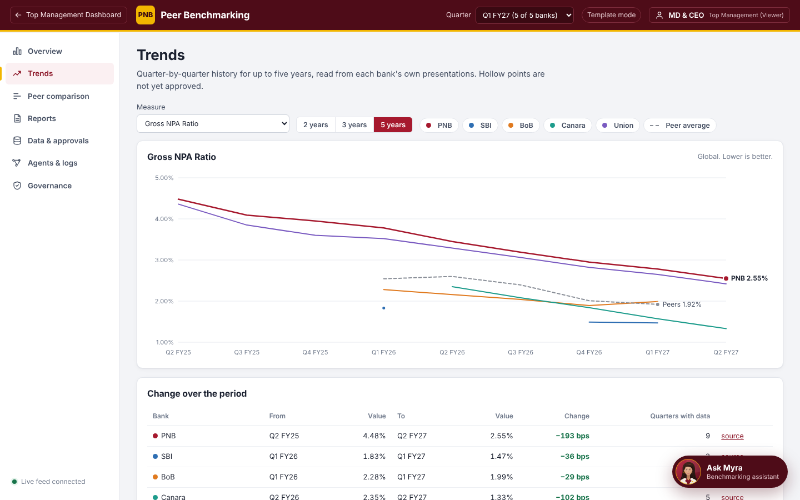

# Opening Peer Benchmarking from the Top Management Dashboard

Peer Benchmarking is a separate web application. The dashboard opens it when an executive clicks the
**Peer Benchmarking** tab. There are three ways to do that; option B is recommended.

| Option | What the executive experiences | Work on the dashboard side | Work on the app side |
| --- | --- | --- | --- |
| **A. Plain link** | Clicks the tab, sees the Peer Benchmarking sign-in page, signs in | Point the tab at the app's address | Create an account per executive |
| **B. One-click sign-in** (recommended) | Clicks the tab and lands directly on the chosen screen, already signed in | One server-side call, then a redirect | Set a shared secret |
| **C. Embedded** | Same as B, but the app appears inside the dashboard page | As B, plus an iframe | As B, plus allow framing; HTTPS needed if the dashboard is HTTPS |

In every option, the executive sees only **approved** figures, cannot change data, and every sign-in is written
to the app's audit trail.

Throughout this document `APP` means the app's address as the executive's browser reaches it, for example
`http://<app-host>:8077` or, behind HTTPS, `https://peer-benchmarking.pnb.internal`. The person running the
app gives you this address.

---

## Option A: plain link

1. Make the tab a link to `APP/` (same window or a new tab, as the dashboard prefers).
2. Ask the app administrator to create an account for each executive:
   `python -m app.cli add-user <login-id> viewer --name "<Full Name>"`.
3. Optional, recommended: ask the administrator to set `DASHBOARD_URL` (see [Return to the dashboard](#return-to-the-dashboard)).

Nothing else is needed. You can link straight to a screen with `APP/#/trends`; after sign-in the executive lands there.

---

## Option B: one-click sign-in (recommended)

The dashboard has already signed the executive in, so it vouches for them. Its **server** asks the app for a
single-use sign-in ticket and redirects the browser with it. The app swaps the ticket for a normal session.

```mermaid
sequenceDiagram
    participant U as Executive's browser
    participant D as Dashboard server
    participant P as Peer Benchmarking
    U->>D: clicks the Peer Benchmarking tab
    D->>P: POST /api/auth/handoff (X-Handoff-Secret, username, full name, tab)
    P-->>D: { url: APP/?ticket=...#/overview }  (valid 120 s, usable once)
    D-->>U: 302 redirect to that url
    U->>P: opens url; the page exchanges the ticket for a session
    P-->>U: signed in on the requested screen; ticket now spent
```

### One-time setup

On the app server, in `.env` (then restart the app):
```ini
HANDOFF_SECRET=<a long random string, 32+ characters>
DASHBOARD_URL=https://<dashboard-address>/          # adds a "back to dashboard" link
HANDOFF_ALLOWED_IPS=<IP address of the dashboard server>   # optional but recommended
```
Generate the secret with `python -c "import secrets; print(secrets.token_urlsafe(48))"` and give it to the
dashboard team through a secure channel. Store it in the dashboard's **server-side** configuration only.

### The call

`POST APP/api/auth/handoff`

Headers: `Content-Type: application/json` and `X-Handoff-Secret: <HANDOFF_SECRET>`

Body:

| Field | Required | Meaning |
| --- | --- | --- |
| `username` | yes | the executive's stable login ID in the dashboard (letters, digits, `.` `_` `-` `@`; up to 64) |
| `full_name` | no | shown in the app's top bar; used when the account is first created |
| `tab` | no | `overview` (default), `trends`, `compare` or `reports` |
| `embed` | no | `true` hides the app's own header and menu (for option C) |

Success, HTTP 200:
```json
{
  "url": "http://<app-host>:8077/?ticket=eyJ1Ijo...#/overview",
  "path": "/?ticket=eyJ1Ijo...#/overview",
  "ticket": "eyJ1Ijo...",
  "expires_in": 120,
  "role": "viewer",
  "user_created": false
}
```
Redirect the browser to `url`. If the dashboard server reaches the app at a different address from the
browser (for example an internal hostname), redirect to `APP + path` instead.

Errors:

| HTTP | Meaning | What to do |
| --- | --- | --- |
| 401 | wrong or missing `X-Handoff-Secret` | check the secret on both sides |
| 403 | the dashboard server's IP is not in `HANDOFF_ALLOWED_IPS`; or the account is an analyst, approver or administrator (they must sign in with their own password); or the user is disabled; or unknown users are not auto-created | as the message says |
| 404 | one-click sign-in is switched off (`HANDOFF_SECRET` empty or too short) | set it and restart the app |
| 422 | invalid `username` or `tab` | send a valid value |

Accounts: an executive who does not yet exist in the app is created on first use as a read-only **viewer**
(switch off with `HANDOFF_AUTO_CREATE=false`). Existing viewer accounts are reused. Staff accounts are refused
on purpose, so that every approval is tied to a password sign-in.

### Examples

curl (useful for testing from the dashboard server):
```bash
curl -s -X POST "$APP/api/auth/handoff" \
  -H "Content-Type: application/json" -H "X-Handoff-Secret: $HANDOFF_SECRET" \
  -d '{"username":"md.ceo","full_name":"MD & CEO","tab":"overview"}'
```

Python (Flask or Django view):
```python
import os, requests
from flask import redirect

APP = os.environ["PEER_BENCH_URL"]              # e.g. http://<app-host>:8077
SECRET = os.environ["PEER_BENCH_HANDOFF_SECRET"]

def open_peer_benchmarking(current_user):
    r = requests.post(f"{APP}/api/auth/handoff", timeout=10,
                      headers={"X-Handoff-Secret": SECRET},
                      json={"username": current_user.login_id, "full_name": current_user.name, "tab": "overview"})
    r.raise_for_status()
    return redirect(APP + r.json()["path"], code=302)
```

Node.js (Express, Node 18+):
```javascript
app.get('/peer-benchmarking', requireLogin, async (req, res) => {
  const r = await fetch(`${process.env.PEER_BENCH_URL}/api/auth/handoff`, {
    method: 'POST',
    headers: { 'Content-Type': 'application/json', 'X-Handoff-Secret': process.env.PEER_BENCH_HANDOFF_SECRET },
    body: JSON.stringify({ username: req.user.loginId, full_name: req.user.name, tab: 'overview' }),
  });
  if (!r.ok) return res.status(502).send('Peer Benchmarking is not available right now');
  const { path } = await r.json();
  res.redirect(302, process.env.PEER_BENCH_URL + path);
});
```

Java (Spring MVC, Java 11+):
```java
@GetMapping("/peer-benchmarking")
public void open(Principal user, HttpServletResponse resp) throws Exception {
    String body = new ObjectMapper().writeValueAsString(Map.of(
        "username", user.getName(), "full_name", lookupFullName(user), "tab", "overview"));
    HttpRequest req = HttpRequest.newBuilder(URI.create(appUrl + "/api/auth/handoff"))
        .header("Content-Type", "application/json").header("X-Handoff-Secret", handoffSecret)
        .POST(HttpRequest.BodyPublishers.ofString(body)).build();
    HttpResponse<String> r = HttpClient.newHttpClient().send(req, HttpResponse.BodyHandlers.ofString());
    if (r.statusCode() != 200) { resp.sendError(502, "Peer Benchmarking is not available right now"); return; }
    String path = new ObjectMapper().readTree(r.body()).get("path").asText();
    resp.sendRedirect(appUrl + path);
}
```

C# (ASP.NET Core):
```csharp
[Authorize, HttpGet("/peer-benchmarking")]
public async Task<IActionResult> OpenPeerBenchmarking()
{
    using var req = new HttpRequestMessage(HttpMethod.Post, $"{_appUrl}/api/auth/handoff")
    {
        Content = JsonContent.Create(new { username = User.Identity!.Name, full_name = GetFullName(), tab = "overview" })
    };
    req.Headers.Add("X-Handoff-Secret", _handoffSecret);
    var r = await _http.SendAsync(req);
    if (!r.IsSuccessStatusCode) return StatusCode(502, "Peer Benchmarking is not available right now");
    var path = (await r.Content.ReadFromJsonAsync<JsonElement>()).GetProperty("path").GetString();
    return Redirect(_appUrl + path);
}
```

The tab in the dashboard's front end is then simply a link to the dashboard's own route, for example
`<a href="/peer-benchmarking">Peer Benchmarking</a>` (add `target="_blank"` to open a new browser tab).

### Rules that keep this safe

- Call `/api/auth/handoff` **only from the dashboard's server**. Never from browser JavaScript: the secret would be exposed.
- Never log or store the ticket. It expires after 120 seconds and works once, but it is still a sign-in.
- Send the executive's real, stable login ID as `username`, so the audit trail names the right person.
- Use HTTPS between browser and app in production (see the Linux guide), and set `HANDOFF_ALLOWED_IPS`.
- Rotate `HANDOFF_SECRET` if it may have leaked: change it on both sides and restart the app.

---

## Option C: embedded in the dashboard page

1. Do everything in option B, with `"embed": true` in the call.
2. Put the returned address in an iframe: `<iframe src="APP + path" style="width:100%;height:100vh;border:0"></iframe>`
3. On the app server, allow the dashboard to frame it, in `.env`: `FRAME_ANCESTORS='self' https://<dashboard-address>`
4. If the dashboard is served over HTTPS, the app must be too: browsers block an `http://` frame inside an
   `https://` page. Put the app behind HTTPS (nginx example in [INSTALL-LINUX.md](INSTALL-LINUX.md#optional-https-with-nginx)).

Inside a frame the app keeps the session in that browser tab only, so each new dashboard visit performs a fresh
hand-off. That is expected.

---

## Return to the dashboard

Set `DASHBOARD_URL` (and optionally `DASHBOARD_NAME`) in the app's `.env`. The app then shows a
"← Top Management Dashboard" link in its top bar, and **Sign out** takes the executive back there.



## Screens you can open directly

| `tab` value or address ending | Screen |
| --- | --- |
| `overview` · `#/overview` | where PNB stands this quarter, with takeaways |
| `trends` · `#/trends` | up to five years of history per KPI |
| `compare` · `#/compare` | all banks side by side, Excel download |
| `reports` · `#/reports` | approved briefs and board packs |

## Showing the numbers natively instead

If the dashboard should draw the figures itself, its server can read them as JSON with a viewer account.
Sign in with `POST APP/api/auth/login` (`{"username": "...", "password": "..."}`) and send the returned token as
`Authorization: Bearer <token>`. Main endpoints:

| Endpoint | Returns |
| --- | --- |
| `GET /api/bench/scorecard?quarter_key=272` | every KPI for every bank: value, rank, peer average, gap (quarter key = FY × 10 + quarter, so Q2 FY27 = 272) |
| `GET /api/bench/trend?kpi=GNPA&n=20` | up to 20 quarters per bank plus the peer average |
| `GET /api/bench/facts` | numbered fact sheet and insights (strengths, concerns, suggested actions) |
| `GET /api/bench/lineage?bank=PNB&kpi=NIM&quarter_key=272` | source document, page, evidence and approvals for one number |
| `GET /api/bench/export.xlsx` | Excel workbook of the scorecard |
| `GET /healthz` | `{"ok": true}` when the app is up (no sign-in needed; use it for monitoring) |

Full, interactive API documentation: `APP/docs`. Call the API from the dashboard's server; the app does not
accept cross-origin calls from other sites' browser code.

## Testing without the dashboard

On the app server, with the environment active, print a one-time link exactly like the one the hand-off returns:
```bash
python -m app.cli link gm --tab trends
```
Open it within two minutes; it signs you in as `gm` on the Trends screen. Opening it a second time shows
"This sign-in link has expired or was already used", which is correct.

## Checking that it works

In the app, sign in as **admin**, open **Governance, Audit trail**. Each dashboard visit leaves two entries:
`auth.handoff.issued` (the dashboard asked for a ticket) and `auth.login.handoff` (the browser used it).
Refused requests appear as `auth.handoff.refused` with the reason.

| Symptom | Cause |
| --- | --- |
| Executive lands on the sign-in page with "expired or was already used" | the redirect took longer than 120 s, the ticket was opened twice, or a link checker opened it first |
| Dashboard gets 404 from `/api/auth/handoff` | `HANDOFF_SECRET` not set, shorter than 32 characters, or the app was not restarted |
| Dashboard gets 403 | its IP is not in `HANDOFF_ALLOWED_IPS`, or the username belongs to a staff account |
| Blank frame in option C | `FRAME_ANCESTORS` does not list the dashboard, or an http app inside an https dashboard |
| Browser cannot reach the app at all | firewall port closed, or `HOST=127.0.0.1` without a reverse proxy |
